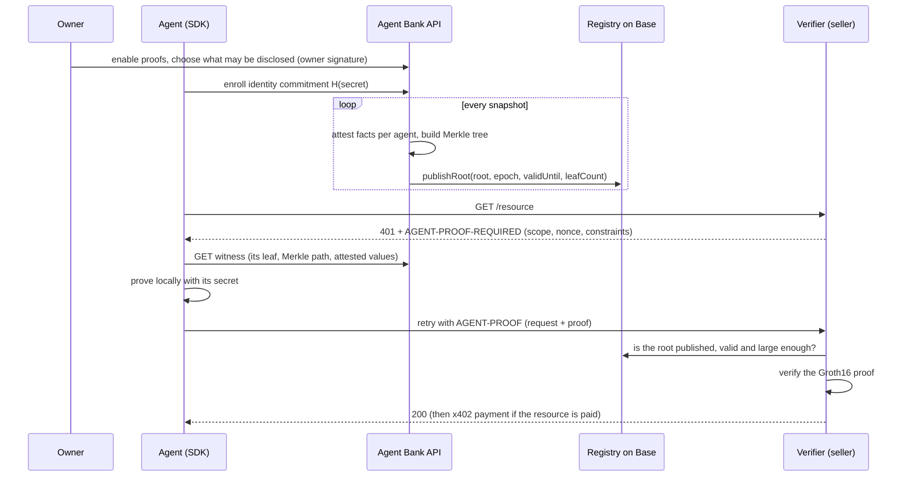

# Private proofs: design

**Status:** accepted for Base Sepolia (ADR 0014). **Owner:** Agent Bank core team.
**Scope:** three products built on one zero-knowledge circuit: agent credentials, private
reputation and proof of funds.

## Summary

Agent Bank knows things about every agent that a counterparty would like to know: that a
verified business stands behind it, that its spending is capped, that it can pay, that it has
completed work before without losing disputes. Today the only way to show any of that is to
reveal who the agent is, and because agent accounts are public on Base, revealing the account
reveals its balance and its whole payment history.

Private proofs let an agent prove a statement about itself ("a verified company backs me, I can
pay up to $5 a call, I have more than $1,000") **without revealing which agent it is, which
company backs it, or the underlying numbers.** Agent Bank attests the facts; the agent proves
them; the verifier learns only that the statement is true.

| Product                                   | The agent proves                                                                                                                                                             | Typical verifier                                                       |
| ----------------------------------------- | ---------------------------------------------------------------------------------------------------------------------------------------------------------------------------- | ---------------------------------------------------------------------- |
| **Agent credentials** ("Know Your Agent") | A verified business or person backs me; my per-transaction and daily limits are within a range                                                                               | Paid APIs, MCP tool providers, marketplaces deciding whom to serve     |
| **Private reputation**                    | I have settled at least N payments, completed at least M escrows, lost no more than K disputes, paid at least C distinct counterparties, and my account is older than D days | Task marketplaces and agents choosing whom to hire or trust            |
| **Proof of funds**                        | I hold at least $X now, or **$X is reserved for you** until time T                                                                                                           | Sellers taking bids, agents negotiating a job before committing escrow |

All three are the same proof over different attributes, so a verifier can ask for any
combination in one request ("a verified company, at least $500 reserved for me for an hour, no
lost disputes").

## How it works



1. **Enrollment.** The agent generates a random `secret` and registers only its commitment,
   `identity = Poseidon(secret)`. Agent Bank never learns the secret, so it cannot produce
   proofs on the agent's behalf.
2. **Attestation.** For every enrolled agent whose owner enabled proofs, Agent Bank computes 13
   attributes from its own records (KYB status, policy, ledger, payments, escrows), hashes them
   with the owner's disclosure mask into a leaf, and builds a depth-20 Poseidon Merkle tree.
3. **Anchoring.** Agent Bank's attester key publishes the tree's root, epoch, snapshot time,
   validity window and leaf count to `AgentAttestationRegistry` on Base. Anchoring makes the
   attestation public and timestamped, and stops Agent Bank from showing different verifiers
   different trees.
4. **Proving.** A verifier issues a proof request: its scope (who it is), a fresh nonce and the
   bounds it needs. The agent fetches its witness from Agent Bank and proves, in zero knowledge,
   that some leaf in a published tree is its own and that its attributes lie within the bounds.
5. **Verifying.** The verifier recomputes the public inputs from its own request, checks the
   root in the registry (published, not revoked, fresh enough, enough leaves) and verifies the
   proof: off-chain in about 15 ms with the SDKs, or on-chain with `AgentClaimsVerifier` for
   about 390,000 gas (around a cent on Base).

## Attested facts

Every leaf commits to the same 13 attributes, all integers below 2^64, in this order (schema
`agentbank.claims.v1`). Amounts are USDC minor units (6 decimals).

| #   | Attribute                | Value                                                                                                    | Disclosure class |
| --- | ------------------------ | -------------------------------------------------------------------------------------------------------- | ---------------- |
| 0   | `principal_verification` | 0 not verified, 1 verified individual, 2 verified company (`org.kyc_status = 'approved'`, by `org.kind`) | `principal`      |
| 1   | `per_tx_limit`           | Effective policy per-transaction cap; 2^64 − 1 if uncapped; 0 with no policy (nothing can be spent)      | `limits`         |
| 2   | `per_day_limit`          | Effective policy rolling 24-hour cap, same encoding                                                      | `limits`         |
| 3   | `balance`                | Available (`operating`) balance at the snapshot, **floored to whole dollars**                            | `balance`        |
| 4   | `reserved_amount`        | Amount of the reservation this leaf represents (0 in the base leaf)                                      | `reservations`   |
| 5   | `reserved_until`         | Unix seconds the reservation lasts until (0 in the base leaf)                                            | `reservations`   |
| 6   | `reserved_for`           | Low 64 bits of the verifier scope the reservation is for (0 in the base leaf)                            | `reservations`   |
| 7   | `account_created_on`     | Account creation time, **floored to the UTC day**, in unix seconds                                       | `account_age`    |
| 8   | `payments_settled`       | Count of settled outgoing payments (transfer, payout, x402, escrow, stream)                              | `reputation`     |
| 9   | `volume_settled`         | Sum of those payments, floored to whole dollars                                                          | `reputation`     |
| 10  | `escrows_completed`      | Escrows released to the agent as payee                                                                   | `reputation`     |
| 11  | `disputes_lost`          | Resolved disputes in which the agent received less than half of the escrow                               | `reputation`     |
| 12  | `counterparties`         | Distinct counterparties across settled outgoing payments and escrows completed as payee                  | `reputation`     |

A verifier expresses each requirement as a bound: `[min, max]` per attribute, with `[0, 2^64 −
1]` meaning "don't care". Equality is `min = max`. "Verified company" is
`principal_verification ∈ [2, 2]`; "can pay a $5 call" is `per_tx_limit ≥ 5_000000`; "no lost
disputes" is `disputes_lost ≤ 0`; "account older than 90 days" is `account_created_on ≤ now − 90
days`.

Amounts and dates are deliberately coarse (whole dollars, whole days) so that a verifier probing
with many thresholds learns less, and so the creation date cannot be matched to the account's
deployment transaction on-chain.

## Owner control

Disclosure is the owner's decision, not the agent's. Per agent, the owner sets:

- `enabled`: whether the agent appears in the tree at all; and
- `disclose`: which classes may be constrained: `principal`, `limits`, `balance`,
  `reservations`, `account_age`, `reputation`.

The classes become a 13-bit **disclosure mask** hashed into the leaf. The circuit enforces it:
for every attribute whose bit is clear, the verifier's bounds must be exactly `[0, 2^64 − 1]`,
so no proof can say anything about an undisclosed attribute, not even a trivial one.

Changes follow the policy engine's asymmetry:

- **Widening** (enabling proofs or adding a class) needs an owner signature (`proofs.disclose`
  owner action) and takes effect at the next root.
- **Narrowing** (disabling or removing a class) needs only an API key and is urgent: Agent Bank
  rebuilds the tree immediately, publishes the new root and **revokes every older root that is
  still valid**, so proofs from the wider disclosure stop verifying as soon as the revocation
  lands. Freezing an agent or org, and an owner releasing a reservation early, do the same.

## Proof of funds and reservations

A balance proof ("at least $1,000 at the last snapshot") is a snapshot: the agent could spend the
money a minute later, and it can show the same proof to every verifier. For commitments that
matter, the agent **reserves** funds for one verifier:

1. The agent calls `POST /v1/accounts/{id}/proofs/reservations` with an amount, the verifier's
   scope (or just its 64-bit tag) and an expiry (at most 7 days).
2. Agent Bank places a ledger hold (`operating → reserved`, `ref_type = proof_reservation`). The
   agent can no longer spend those funds through Agent Bank: every payment first holds from
   `operating`, which no longer covers them.
3. At the next root the agent gains a second leaf with `reserved_amount`, `reserved_until` and
   `reserved_for = tag(scope)`. A verifier that asks for `reserved_amount ≥ X`, `reserved_until ≥
T` and `reserved_for = tag(its own scope)` learns that $X is held **for it** until T. The
   same reservation proves nothing to any other verifier, so it cannot be pledged twice.
4. The reservation cannot be cancelled by the agent before it expires. The **owner** can release
   it early with an owner signature (the owner is always sovereign), which revokes every root
   containing it. On expiry the hold is voided and the funds return to `operating`.

Agent Bank is non-custodial, so a reservation binds the agent and Agent Bank's co-signer, not the
owner: the owner can still withdraw on-chain at any time with the owner key. The guarantee a
verifier gets is "the agent cannot spend this through Agent Bank until T, and the owner would
have to deliberately exit to break it". Paying the verifier still happens through a normal
payment or escrow; settling directly from a reservation is a follow-up.

## Trust model

What a verifier must trust:

- **Agent Bank as the attester.** The proof shows that Agent Bank attested the facts, not that
  the facts are true on-chain. A compromised attester key could attest false facts or pad the
  tree. Controls: the attester key is separate from every key that can touch funds (it can move
  nothing), lives in KMS outside testnet, every root is public and permanent on Base, and the
  registry admin (a governance multisig) can rotate the attester and revoke roots.
- **The trusted setup.** Groth16 needs a one-time setup; whoever learns its secret randomness
  can forge proofs. The current keys come from a **single-party, testnet-only** ceremony.
  Mainnet requires a public multi-party ceremony (ADR 0003 in `contracts`).
- **The circuit.** It must be audited before mainnet, alongside the contracts.

What stays private, from whom:

| Party                   | Learns                                                                                                  | Does not learn                                                                      |
| ----------------------- | ------------------------------------------------------------------------------------------------------- | ----------------------------------------------------------------------------------- |
| Verifier                | The statement is true; a per-verifier pseudonym (the nullifier); which root (so: roughly when)          | Which agent, account, org or address; the attribute values                          |
| Two colluding verifiers | Nothing more: nullifiers differ per scope                                                               | Whether two proofs came from the same agent                                         |
| Agent Bank              | Who enrolled, the attested values (it computed them), reservation tags, when an agent fetched a witness | Which verifier an agent proved to (except through reservation tags), the nullifiers |
| Agent Bank + a verifier | Timing correlation between witness fetches and proofs                                                   | The nullifier-to-agent mapping: computing a nullifier needs the agent's secret      |
| Anyone on-chain         | Roots, epochs, leaf counts, validity windows                                                            | Leaves and attributes                                                               |

Known limits, stated plainly:

- **Payments are not private.** If the agent then pays the verifier with x402, the payment comes
  from its spend key, which is linked on-chain to its account. Proofs keep the facts private;
  they do not make the payment rail anonymous. Proofs are most private when used for admission,
  bids and negotiation before (or without) a payment.
- **The anonymity set is the tree.** A proof hides the agent among the leaves of that root.
  Verifiers set `min_anonymity_set`; the SDK defaults to 16. A small deployment has small trees.
- **Probing.** A verifier can ask many questions with different thresholds. Coarse values and the
  per-scope nullifier (which lets the verifier be recognized as the same asker) limit this; the
  SDK can also refuse requests per its own disclosure rules (`maxPresentationsPerScopePerHour`).
- **Freshness.** Facts are as of the snapshot. Roots are valid for `PROOFS_ROOT_TTL_SECONDS`
  (default two hours) unless revoked earlier.

## Cryptography

- **Circuit:** `contracts/circuits/agent_claims.circom`, Circom 2.2.3, circomlib 2.0.5, Groth16 on
  BN254, 10,270 constraints. Proving takes about 1.3 s in Node; verification about 15 ms.
- **Leaf:** `Poseidon(identity, Poseidon(attributes[0..12], mask))`, `identity = Poseidon(secret)`.
- **Tree:** depth 20 (about one million leaves), Poseidon(2) nodes, empty subtrees hash from
  zero leaves (`zero[0] = 0`, `zero[i+1] = Poseidon(zero[i], zero[i])`). `pathBits[i] = 1` when
  the node at level `i` is a right child. Leaves are ordered by account id, then reservation id,
  followed by the epoch's salt leaf (see [Roots](#roots)).
- **Nullifier:** `Poseidon(secret, scope)`: the same agent and verifier always produce the same
  value; different verifiers get unlinkable values.
- **Public signals (30):** `nullifier, root, scope, nonce, mins[13], maxs[13]`.
- **Scope:** for an HTTP verifier, `scope = keccak256(utf8("agentbank.proofs.scope.v1:" +
scope_id)) mod r`, where `scope_id` is the verifier's host name (or any identifier up to 253
  characters) and `r` is the BN254 scalar field order. For an on-chain consumer, `scope =
keccak256(abi.encode("agentbank.proofs.scope.v1", chainId, consumer, context)) mod r`
  (`AgentClaimsVerifier.scopeOf`). The reservation tag is `scope mod 2^64`.
- **Nonce:** 31 bytes (fits the field). Stateless verifiers derive it as the first 31 bytes of
  `HMAC-SHA256(gate_key, canonicalJson(request without nonce))` and remember used nonces until
  the request expires.

Artifacts (`agent_claims.wasm`, `agent_claims.zkey`, `verification_key.json`, `manifest.json`)
are produced in `contracts/circuits`, verified by its CI against the circuit and the ceremony
file, and copied into `packages/proofs/artifacts` by `pnpm --filter @agentbank/proofs
sync-circuits`, which checks the manifest hashes.

## Protocol

### Proof request (verifier → agent)

```json
{
  "type": "agentbank.proof_request.v1",
  "scope": "api.seller.example",
  "request_id": "9f2c1b0e5a7d4c3b8e6f1a2b3c4d5e6f",
  "nonce": "0x5e1a…(62 hex digits)",
  "issued_at": 1760000000,
  "expires_at": 1760000300,
  "constraints": {
    "principal_verification": { "min": "2", "max": "2" },
    "per_tx_limit": { "min": "5.00" },
    "reserved_amount": { "min": "500.00" },
    "reserved_until": { "min": "1760003600" },
    "reserved_for": { "min": "1311768467463790320", "max": "1311768467463790320" },
    "disputes_lost": { "max": "0" }
  },
  "max_root_age_seconds": 7200,
  "min_anonymity_set": 16,
  "chain_id": 84532,
  "registry": "0x…"
}
```

- Money attributes (`per_tx_limit`, `per_day_limit`, `balance`, `reserved_amount`,
  `volume_settled`) take decimal USDC strings; every other attribute takes base-10 integer
  strings. Omitted attributes and omitted `min`/`max` are unconstrained.
- `request_hash = canonicalKeccak(request)` (the same canonical JSON as owner authorizations).
- SDK builders: `verifiedPrincipal()`, `verifiedCompany()`, `canPayPerTx(amount)`,
  `canPayPerDay(amount)`, `spendingCappedAt({ perTx, perDay })`, `balanceAtLeast(amount)`,
  `reservedFor(amount, { until })`, `accountOlderThan(days)`, `reputation({ paymentsSettled,
volumeSettled, escrowsCompleted, disputesLostAtMost, counterparties })`.

### Presentation (agent → verifier)

```json
{
  "type": "agentbank.proof.v1",
  "request_hash": "0x…",
  "root": "0x…(32 bytes)",
  "nullifier": "0x…(32 bytes)",
  "proof": {
    "pi_a": ["…", "…", "1"],
    "pi_b": [
      ["…", "…"],
      ["…", "…"],
      ["1", "0"]
    ],
    "pi_c": ["…", "…", "1"],
    "protocol": "groth16",
    "curve": "bn128"
  }
}
```

The verifier never takes public signals from the agent: it rebuilds them from its own request,
the presented root and the presented nullifier.

### HTTP

| Step                      | Status | Header                                                                                           |
| ------------------------- | ------ | ------------------------------------------------------------------------------------------------ |
| Verifier asks for a proof | 401    | `WWW-Authenticate: AgentProof realm="<scope>"` and `AGENT-PROOF-REQUIRED: base64(json(request))` |
| Agent retries             | —      | `AGENT-PROOF: base64(json({ request, presentation }))`                                           |
| Verifier accepts          | 2xx    | `AGENT-PROOF-RESPONSE: base64(json({ status: "accepted", nullifier }))`                          |

A resource can require both a proof and a payment: the proof gate runs first (401), then the
x402 paywall (402). The SDKs handle both in one call.

### Verification checks, in order

1. The request has not expired and, for gates, its nonce is authentic and unused.
2. `presentation.request_hash` equals the hash of the verifier's request.
3. The root is published in the registry of `chain_id`, not revoked, before `valid_until`, no
   older than `max_root_age_seconds`, and has at least `min_anonymity_set` leaves.
4. The Groth16 proof verifies against `[nullifier, root, scope(request.scope), nonce, mins,
maxs]`.

Failure reasons: `malformed`, `request_expired`, `nonce_invalid`, `nonce_reused`,
`request_hash_mismatch`, `unknown_root`, `root_revoked`, `root_expired`, `root_too_old`,
`anonymity_set_too_small`, `invalid_proof`.

## Roots

- The `proofs-roots` job runs every 30 seconds and builds a new root when the tree is dirty
  (enrollment, settings, reservation, freeze) or the last root is older than
  `PROOFS_ROOT_INTERVAL_SECONDS` (default 3,600). Empty trees are not published.
- Each root records `epoch` (strictly increasing), `snapshot_at`, `valid_until = snapshot_at +
PROOFS_ROOT_TTL_SECONDS` (default 7,200), `leaf_count`, the transaction hash and a status:
  `publishing → published → (revoked | expired)`, or `failed`.
- Every tree ends with a public **salt leaf** after the attested leaves:
  `keccak256(abi.encode("agentbank.proofs.epoch-salt.v1", chainId, epoch)) mod r`. The registry
  refuses a root it has seen, and an unchanged set of facts would hash to the same tree. No one
  knows a Poseidon preimage of the salt, so it proves nothing, and `leaf_count` (the anonymity
  set) counts only the attested leaves.
- Leaves are stored per epoch so witnesses can be served for every valid root. Roots older than
  their validity window are pruned after a day.
- A build triggered by a narrowing change revokes all older valid roots after the new one lands.

## Contracts

`AgentAttestationRegistry` (holds no funds):

- `publishRoot(root, epoch, snapshotAt, validUntil, leafCount)`, attester only. Requires a
  non-zero root below the field order, `epoch > latestEpoch`, `snapshotAt ≤ now`, `now <
validUntil ≤ now + 7 days`, `leafCount > 0`, and a root not published before.
- `revokeRoots(roots[])`, attester or admin. `setAttester(next)`, admin only. Admin is
  `Ownable2Step` (a governance multisig).
- Views: `rootInfo(root)`, `isValidRoot(root)`, `latestRoot()`, `latestEpoch()`, `attester()`.

`AgentClaimsVerifier` wraps the generated `AgentClaimsGroth16Verifier`:

- `scopeOf(consumer, context)` derives an on-chain scope.
- `verify(claims, proof, minAnonymitySet, maxRootAge)`, a view that returns false on any
  failure.
- `verifyAndConsume(context, claims, proof, minAnonymitySet, maxRootAge)`: requires `claims.scope
== scopeOf(msg.sender, context)`, marks `(scope, nonce)` used, emits `ClaimsAccepted` and
  returns the nullifier, so a contract can admit each agent once (sybil-resistant voting,
  allowlists, marketplace admission).

## API

All under the `Proofs` tag.

| Operation                 | Route                                        | Auth                                        |
| ------------------------- | -------------------------------------------- | ------------------------------------------- |
| `getProofCircuit`         | `GET /v1/proofs/circuit`                     | public                                      |
| `listProofRoots`          | `GET /v1/proofs/roots`                       | public                                      |
| `getProofRoot`            | `GET /v1/proofs/roots/{root}`                | public                                      |
| `verifyProof`             | `POST /v1/proofs/verify`                     | public                                      |
| `getProofSettings`        | `GET /v1/agents/{id}/proofs/settings`        | principal                                   |
| `updateProofSettings`     | `PUT /v1/agents/{id}/proofs/settings`        | principal (+ owner signature when widening) |
| `enrollProofIdentity`     | `PUT /v1/accounts/{id}/proofs/identity`      | agent                                       |
| `getProofIdentity`        | `GET /v1/accounts/{id}/proofs/identity`      | agent, principal                            |
| `getProofWitness`         | `GET /v1/accounts/{id}/proofs/witness`       | agent                                       |
| `createProofReservation`  | `POST /v1/accounts/{id}/proofs/reservations` | agent                                       |
| `listProofReservations`   | `GET /v1/accounts/{id}/proofs/reservations`  | agent, principal                            |
| `getProofReservation`     | `GET /v1/proofs/reservations/{id}`           | agent, principal                            |
| `releaseProofReservation` | `POST /v1/proofs/reservations/{id}/release`  | principal (+ owner signature)               |

Webhooks: `proof_settings.updated`, `proof_reservation.created`, `proof_reservation.released`,
`proof_reservation.expired`. Feature flag: `FEATURE_PRIVATE_PROOFS` (on by default; testnet
only like everything else).

## Developer surface

- **TypeScript:** `agent.proofs.enroll()`, `agent.proofs.prove(request)`,
  `agent.proofs.reserve({ amount, scope, expiresAt })`; `fetchWithPayment` answers proof
  challenges automatically when the agent has a proof secret. Verifiers use
  `@agentbank/sdk/proof-server`: `createProofGate({ scope, key, require })` plus adapters for
  Web `Request`, Express, Hono, Fastify and Node, mirroring the x402 paywall.
- **Python:** `agentbank.proofs` builds requests, verifies presentations (pure Python, `py_ecc`)
  and runs a stateless `ProofGate`; proving shells out to the `agentbank-prove` CLI from
  `@agentbank/proofs`, because proving needs the circuit's WebAssembly witness generator.
- **MCP:** `prove_claims` and `reserve_funds_for_proof` tools; `fetch_paid_resource` answers
  proof challenges.
- **Console:** a "Private proofs" card per agent: enable, choose classes (owner signature when
  widening), enrollment, reservations and the latest root.

## What needs people

1. A specialist audit of the circuit and the two contracts.
2. A public multi-party trusted setup before mainnet (phase 1 from a public Powers of Tau,
   phase 2 with independent contributors).
3. Counsel: whether attesting customer facts to third parties needs consent language in the
   terms, and how private proofs interact with AML expectations (they reveal less to
   counterparties, never less to Agent Bank or regulators).
4. An attester key in KMS and a small ETH balance on Base for root transactions.

## Roadmap

- **Trustless proof of funds:** prove the on-chain USDC balance of a hidden account with storage
  proofs, removing the attester from balance claims.
- **Settle from a reservation:** pay the reserved verifier directly from the held funds.
- **Per-attribute consent and fresher roots** for high-volume deployments.
- **Private payments:** out of scope until privacy-preserving USDC rails mature.
